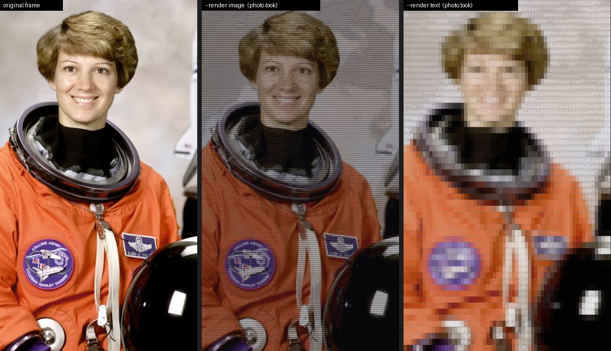
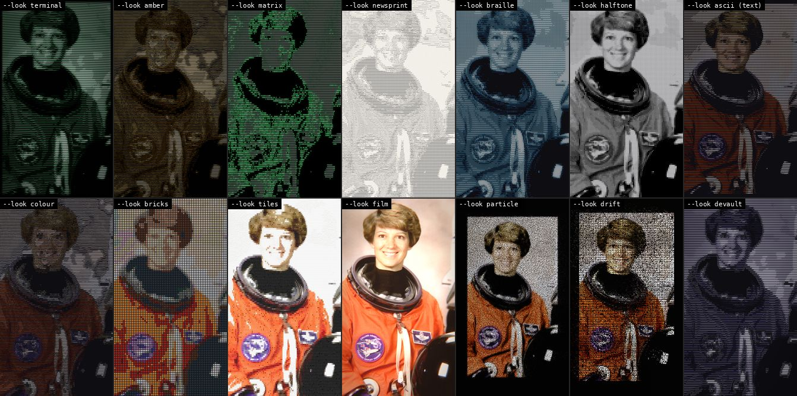

# insta-ascii

Your Instagram **Reels feed, in the terminal**. The CLI signs in to your account, opens the Reels
page, and renders the playing video with the
[Devault ASCII generator](https://devault-ascii.pages.dev/ascii-generator/app/): its 13 styles, its
preset looks and every one of its controls. **With sound.**



<sub>One frame of a test video made from a NASA public-domain photograph (not Instagram content). Left to right:
the original, `--render image`, `--render text`. Both renderings use the `photo` look.</sub>

## What it looks like, and why

There are three ways to draw, and all three come from the app's own engine:

| `--render` | What you see | Works in |
| --- | --- | --- |
| `text` | **real characters**, true colour, each cell tinted with the picture under it | every terminal |
| `image` | **the app's actual canvas** at pixel resolution: every style, every effect | terminals that show images: kitty, Ghostty (kitty protocol); iTerm2, WezTerm, mintty (iTerm2 protocol) |
| `blocks` | that same canvas as half-block pixels | any truecolor terminal |

`auto` (the default) picks `image` where the terminal can show it, otherwise `text`.

The default look, **`photo`**, is the "realistic but still ASCII" one: the picture stays visible underneath
detailed, true-colour letters. It uses the app's own *"Keep the image underneath"* feature. Raise **Image
visibility** (`--set underlay=80`) for more photo, lower it for more ASCII. **`ascii`** is the pure-characters look
(below). The other 18 looks are the app's own presets:



### Pure ASCII (`--style classic`) and where the extra detail comes from

Choosing a style yourself (`--style classic`, `--ramp`, `--set style=…`) starts from the **`ascii`** look, not `photo`:
only characters, on one plain backdrop, coloured by the picture. Nothing of the picture is painted behind them, so it
is not the video with a filter on top. (`--look photo --style classic` brings the picture back underneath.)

A terminal can only have as many characters as it has cells, so the extra detail has to come from choosing each
character better. The app, like most converters, averages a cell to one brightness and looks it up in a ramp. This
CLI treats a character as the *shape* it is: each cell is sampled on a 3 × 6 grid and the character whose shape
best fits that pattern is chosen (`-` or `=` for a horizontal feature, `:` or `|` for a vertical one, `.` for
something low in the cell), with brightness still decided first. It applies to the ramp styles (classic, detailed,
minimal, binary, custom) and uses the terminal's real cell shape (asked with `CSI 16 t`; 1:2 is assumed when it
doesn't answer), so the picture is not stretched in terminals whose cells are not exactly twice as tall as wide.


<sub>A public-domain NASA photograph at 130 columns, `--style classic`. Left to right: the original, the app's own
brightness-only mapping, shape-matched characters (the default). Same look, same settings.</sub>

What was measured (two public-domain test photographs, `--style classic`, rendered to a picture and compared with
the source frame; the constants and the sweeps are in `src/shapes.js`):

| | app's mapping | shape-matched |
| --- | --- | --- |
| structural similarity (SSIM), viewed at ¼ size | 0.196 | **0.261** |
| structural similarity (SSIM), viewed at ½ size | 0.154 | **0.202** |
| do the picture's edges land on the same cells? (correlation, 130 columns) | 0.41 | **0.84** |
| does a cell get denser where the picture is brighter? (rank correlation) | 0.90 | **0.97** |
| how much of the ramp is used (entropy, bits) | **3.3** | 2.6 |

**What this does not show, honestly.** The last row goes the other way: shape matching spends more cells on the
densest characters (`@` and `%` are 47 % of cells, against 24 %), because characters with a lot of internal structure
(`+ = - : #`) lose to plainer ones in a smooth area, where there is no pattern for them to follow. Looking at the
image above at 1:1, the app's output has more tonal *banding* in skin and hair, which reads as ASCII-art texture;
some of that is real and some is aliasing (its edge correlation is 0.41, so much of its fine variation is not where
the picture's edges are). The numbers say shape matching is closer to the photograph; whether it looks better is partly
taste, so it is one key away: **`g`** switches between the two while watching, `--glyphs brightness` starts with the
app's mapping, and `--set sharpen=0..100` sets how hard it chases detail. Shape matching does not use the app's
`scatter`, `shimmer` or edge strength / smoothing controls; `--glyphs brightness` keeps those.

### Resolution

- **Image mode** is as sharp as the terminal's pixels (up to ~2400 px on a side) and draws up to 400 glyph
  columns, versus ~45 for a portrait reel in plain letters. `--scale` raises or lowers it.
- **Text mode** can never have more cells than the terminal has: the number of columns is what fits, so a smaller
  font or a bigger window is the one thing that adds real resolution. Within that, the `photo` look gets its
  realism from colour (every cell's background is the picture's colour; the letters are calibrated down for the
  terminal, found by comparing real renders at 1:1) and the `ascii` look from choosing each letter by shape (above).
  Braille (`--style braille`) packs 2×4 dots into each cell and is the most photographic text style, but it is not
  ASCII.

## How it works

```
 Chrome, signed in to Instagram ──► frame of the reel on screen
        (your saved session)                │
                                            ▼
                Devault ASCII generator (loaded from its hosted URL, run in a hidden tab)
                       │ glyph grid + colours                │ the app's own canvas
                       ▼                                     ▼
              text: real characters                image / blocks: pixels
                       └──────────────► your terminal ◄──────┘
```

- A real browser (Playwright, using your installed Chrome when there is one) logs in and plays the reel.
- Each frame is read straight off the playing `<video>` as raw pixels (screenshots are the fallback;
  `--capture page` renders the whole page).
- The hosted app is loaded, its UI script is not run, and its **engine** does the conversion with the app's own
  settings. It only paints a canvas and has no text export, so the CLI reads the glyph grid from the engine,
  using the same glyph-to-character mapping the app uses for its own text output.

## Requirements

- Node.js 18.17 or newer
- Google Chrome, **or** run `npx playwright install chromium` once
- Internet access (Instagram, and `devault-ascii.pages.dev` for the renderer)
- An audio player for **sound**: `ffplay` (comes with ffmpeg), `mpv`, SoX's `play`, `pw-cat`, `paplay` or `aplay`.
  `insta-ascii --list audio` shows what it found. On macOS, `brew install ffmpeg` is enough.
- `ffmpeg` also for recording MP4s

## Install

```bash
git clone https://github.com/othmanehousni/insta-cli.git
cd insta-cli
npm install
npm link        # optional: puts `insta-ascii` on your PATH (otherwise use `node bin/insta-ascii.js`)
```

## Sign in

```bash
insta-ascii login
```

You are asked for your username and password (typed hidden, and never a flag, so it doesn't land in your shell
history). For scripts, set `INSTAGRAM_USERNAME` and `INSTAGRAM_PASSWORD`. If Instagram asks for a two-factor code
you will be prompted for it.

```bash
insta-ascii login --manual
```

Opens a **visible browser window** and waits while you sign in yourself. Use this if Instagram challenges the
automated login (security checks, captchas, "was this you?"). It is the most reliable way in. The session is
saved to a private browser profile and reused by every later run. `insta-ascii logout` deletes it, and a plain
`insta-ascii` signs you in if there is no valid session yet.

## Watch

```bash
insta-ascii
```

| Key | Action |
| --- | --- |
| `j` / `↓`, `k` / `↑` | next / previous reel |
| `space` | pause / resume |
| `Tab` (or `m`) | the **settings panel**: every control of the app (below) |
| `l` / `L` | next / previous look |
| `v` | cycle text / blocks / image rendering |
| `o`, then `[` `]` | **Compare** with the original; move the divider |
| `x` | save the app's canvas as a PNG (and the text as `.txt`) to `~/.insta-ascii/shots` |
| `r` | start / stop recording an **MP4** (needs ffmpeg) |
| `a` | mute / unmute the **sound** |
| `9` / `0` | volume down / up |
| `,` / `.` | move the sound earlier / later against the picture (50 ms) |
| `s` `c` `p` `e` `i` | cycle style · colour · palette · outlines · invert |
| `g` | choose letters by shape / by brightness (text rendering) |
| `+` / `-` | more / less detail |
| `q` | quit |

In the settings panel: `↑↓` select, `←→` change (`⇧←→` ×10), `Enter` edits text and colour fields, `d` resets a
control to the app's default, `Tab` closes. It shows the same sections the app shows for the current style and
hides what the app would hide (for example, edge strength only appears while "Trace edges" is on).

## Everything the app offers

| In the app | Here |
| --- | --- |
| 13 styles: classic, detailed, blocks, tiles, minimal, binary, braille, dots, dither, bricks, particle, film, custom | `--style`, `s`, or the panel; `insta-ascii --list styles` |
| the preset **looks** rail (18 looks) | `--look <id>`, `l` / `L`; `--list looks`. Their settings are read from the live app, not copied. This CLI adds two: `photo` and `ascii` |
| every slider, switch and choice (all 52 controls: detail, spacing, tile gaps, particles, film, tone, colour, background, contours, effects…) | the panel, or `--set key=value` for any of them; `--list settings` shows keys, ranges and defaults |
| palettes (7), colour modes (original / palette / mono), background modes (dark / black / paper / custom / clear) | `--palette`, `--color`, `--set bgMode=paper`, … |
| effects: bloom, scanlines, curvature, chromatic aberration, vignette, grain, flicker, twinkle, animate | panel or `--set`. **Bloom, curvature and chromatic aberration are pixel effects**: image / blocks rendering only. Vignette, scanlines, grain and flicker are also emulated per cell in text |
| particle and film styles | image / blocks only (they are not made of characters). In text rendering the CLI switches to blocks for you |
| "Keep the image underneath", Compare | yes (text, image and blocks) |
| Export image / video | `x` and `--once --out file.png` (PNG at export resolution); `r` records an MP4 |
| Upload / Sample | `--file photo.jpg` or `--file clip.mp4`; `--url` for any page |

`--set` examples: `--set underlay=70 --set glyphOpacity=80`, `--set bgMode=paper`, `--set bloom=40 --set scanlines=30`,
`--style custom --ramp " .oO@"`.

**Not ported, deliberately:** the site's Library link and account menu, the scrub bar (a live feed has none),
the immersive view (a terminal is already full-screen), and JPEG/WebP and 720p/1080p/4K export choices (stills are PNG
at 1920 px on the long side, recordings 1280 px). Recordings have no sound.

## Options

| Option | Meaning | Default |
| --- | --- | --- |
| `--look <id>` | start from a look (`insta-ascii --list looks`) | `photo`, or `ascii` once you choose a style |
| `-s, --style <id>` | any of the 13 styles | the look's |
| `--ramp <chars>` | your own ramp, light to dense | |
| `-c, --color <mode>` | `source` `palette` `mono` `none` (none = plain text) | the look's |
| `--palette <id>` | the app's palette | the look's |
| `--glyphs <how>` | `shape` or `brightness`: how each character is chosen in text rendering (see above) | `shape` |
| `--no-edges` · `--invert` | outline tracing off · invert brightness | |
| `-w, --cols <n>` | Detail (columns), 20–400. In text it is also capped by what fits the terminal | the look's |
| `--set <key=value>` | any app setting, repeatable | |
| `--list <what>` | `looks` `styles` `palettes` `settings`, then exit | |
| `--render <mode>` | `auto` `text` `image` `blocks` | `auto` |
| `--graphics <proto>` | `auto` `kitty` `iterm2` | `auto` |
| `--scale <n>` | image resolution multiplier, 0.2–3 | `1` |
| `--depth <mode>` | `auto` `truecolor` `256` `none` (`NO_COLOR` is respected) | `auto` |
| `--fps <n>` | frame-rate cap | `15` |
| `--no-audio` | no sound | sound on |
| `--volume <n>` | starting volume, 0–100 | `100` |
| `--audio-player <p>` | `auto`, a player name, or a command that reads raw PCM on stdin | `auto` |
| `--audio-delay <ms>` | `auto` (measured), or a fixed delay behind the picture | `auto` |
| `--capture <what>` | `video` (the reel) or `page` (the whole viewport) | `video` |
| `--once` | print one frame to stdout and exit (no terminal needed) | |
| `--out <file.png>` | with `--once`: also save the app's canvas as a PNG | |
| `--file <path>` · `--url <url>` | a local image or video · any page, instead of Reels | |
| `-u, --username <name>` | Instagram username | `INSTAGRAM_USERNAME` or prompt |
| `--browser <name>` | `auto` `chrome` `chromium` | `auto` |
| `--headed` · `--software-gl` | show the browser · allow software WebGL (headless, no GPU) | off |
| `--app-url <url>` | the ASCII generator app | the Devault URL |
| `--debug` | verbose logging; saves a screenshot on failure | off |

Run `insta-ascii --help` for the same list.

### Which terminal?

- **kitty, Ghostty:** `--render image` just works (kitty graphics protocol).
- **iTerm2, WezTerm, mintty:** `--render image` just works (iTerm2 inline images).
- **VS Code's terminal:** supports the iTerm2 protocol only if *"terminal.integrated.enableImages"* is on, and a silent blank
  picture is worse than text, so it is never picked automatically: `--graphics iterm2` to opt in.
- **tmux / screen:** they swallow image sequences, so rendering falls back to text. `--render blocks` also works.
- **Apple Terminal, GNOME Terminal, Windows Terminal, …:** text (best with truecolor) or `--render blocks`.
  **Sixel is not supported.**

## Sound

Reels have sound, and so does this. It is on by default whenever an audio player is installed.

```
 the reel's <video> ──► tapped inside the Instagram page ──► 16-bit PCM ──► your audio player ──► speakers
   (may be muted)          (video.captureStream)               (Node)        (ffplay, mpv, …)
```

- **Instagram's mute button doesn't matter.** Instagram starts reels muted; the tap reads the video's audio even
  while the element is muted, so the CLI never fights Instagram's own state. The browser itself stays muted, so
  nothing plays twice.
- **It follows the reel on screen**: scroll to the next reel and you hear that one. A reel with no sound track
  starts no player.
- **Any player that reads audio on stdin works.** `--audio-player auto` picks the first of `ffplay`, `mpv`,
  `play`, `pw-cat`, `paplay`, `aplay` that it finds, and takes the sample rate from the page. `ffplay` is fed a
  self-describing WAV stream (no version-specific options), and if it dies right after starting the CLI tries two
  raw-PCM spellings before giving up. To use something else give a command, for example
  `--audio-player "aplay -q -t raw -f S16_LE -r {rate} -c {channels} -"` (16-bit little-endian stereo on stdin;
  `{rate}` and `{channels}` are filled in; no shell is involved, so no quoting either).
- **Keys:** `a` mutes, `9` / `0` change the volume, and all of them are also in the settings panel (`Tab`) next to
  *Sound delay*. The HUD shows `♪ 100%`, or `♪ muted`.
- **Lip-sync.** The sound is captured live but the picture is drawn a moment after it was captured (longer in
  image mode). The viewer measures that lag, subtracts the tap's own ~190 ms batching, and holds the sound back by
  the remainder. It is an estimate: `,` and `.` nudge it in 50 ms steps if it is off for you, or fix it with
  `--audio-delay <ms>`. `--debug` prints the numbers.
- A player that fails shows `♪ ✗` in the HUD, and the reason (with what the player itself said) is printed after you
  quit, so it is not lost with the screen.
- No player installed? You get one warning and the video carries on silently. `--audio-player ffplay` when ffplay
  is missing is an error instead, since you asked for it by name.
- Sound is not played with `--once`, and recordings (`r`) have none.

### If there is no sound

```bash
insta-ascii audio-test
```

plays a one-second beep through your player, trying each way of starting it, and prints what the player itself said
about any that fail. It judges by how long the player really played, not only by its exit code, because some players
quit instantly and silently when they cannot open an audio output. Typical messages:

| What the player said | Meaning |
| --- | --- |
| `Could not initialize SDL - Audio target … not available` / `SDL_OpenAudio … Couldn't open audio device` / `audio open failed` | the player cannot get an audio **output**: no device selected, another app holds it exclusively, or you are in a session with no sound (SSH, a container, WSL without audio). The sound plays on the machine the CLI runs on. Try `--audio-player mpv` or `play` |
| `Unrecognized option …` / `Option … not found` | this version of the player rejects a flag; the CLI already tries three spellings for `ffplay`, so if all fail open an issue with this output |
| `not found` | the player is not installed (`insta-ascii --list audio`) |

`--no-audio` always gets you a silent viewer.

## Privacy and security

- **Your session** lives in a browser profile at `~/.insta-ascii/profile` (override with `INSTA_ASCII_HOME`), created
  readable by you only. Treat it like a password. `insta-ascii logout` removes it, and refuses to delete a
  directory it didn't create.
- **The renderer tab is locked down.** The hosted app is allowed to make `GET` requests to its own files and nothing
  else. This matters because the app's own Content-Security-Policy *permits* connections to its auth and stats
  services and to Google sign-in. Frames from your feed can't be sent to any of those, or anywhere. The app's UI
  script is not run at all; only its engine is.
- Saved stills and recordings go to `~/.insta-ascii/shots` (private folder). `--debug` screenshots go to
  `~/.insta-ascii/debug`; they can show account details, so delete them when you are done.
- **Sound stays on your machine**: page → this process → your local audio player. The renderer tab never sees it
  (it only receives picture frames), and the function that carries it is only exposed to the Instagram page.
- This tool has no telemetry of its own. (The browser talks to Instagram, of course, and loads the renderer's files
  from the Devault site.)

## Limitations, honestly

- **Instagram's terms** don't allow automated access, and automated sign-ins from a headless browser are more
  likely to be challenged than your normal browser. Use it with your own account, at your own risk, and prefer
  `login --manual`.
- **This was developed without an Instagram account to test against.** Verified: the live Devault engine, every
  style and look, the whole CLI and the interactive viewer in a real pseudo-terminal, reel navigation, pause,
  the screenshot fallback for cross-origin video, and the login flow (password, wrong password, two-factor,
  security challenge, manual) against a local stand-in whose form fields match the real login page (`email` /
  `pass`, checked against the live page). **Not verified:** Instagram's real post-login pages, 2FA form and reels
  markup. Those can change at any time. If something doesn't work, run with `--debug --headed`.
- **The image protocols were checked at the byte level, not on screen.** I had no kitty, Ghostty, iTerm2 or WezTerm
  to look at: the tests decode what the CLI sends back into the original image and check the protocol framing
  against the specifications, but a real terminal may still behave differently. If a picture doesn't appear,
  `--render text` is the safe fallback.
- **Speed depends on a GPU.** Text rendering costs about 70 ms a frame here. Image and blocks rendering run on the
  browser's WebGL: with no GPU (this was developed in one such environment) the heavy looks take ~700 ms a frame at
  full size, so the viewer **lowers the image resolution automatically** to keep up with `--fps` (the HUD shows the
  percentage), reaching ~8 fps at 30 %. With a GPU the render itself should be far faster, but I could not measure
  that. `--scale` sets the maximum resolution.
- **Shape matching is measured, not proven to look better.** The metrics above favour it, a still crop at 1:1 shows the
  app's mapping with more tonal banding, and I had no way to put both in front of a real terminal's eyes. Flip it with
  `g` and decide. In a perfectly flat area it can also pick a directional character (`\`) where there is no direction.
- Text rendering draws 11 of the 13 styles; `film` and `particle` need pixels. Text mode ignores the app's font,
  letter spacing and non-normal blend modes (the terminal chooses its own font), and does not do bloom, curvature or
  chromatic aberration.
- The reels page is driven like a person would: arrow keys, with the mouse wheel as a fallback.
- **Sound could not be heard while developing this**: the machine had no audio device at all. What is verified is
  everything up to the player: a known 440 Hz / 880 Hz tone inside a *muted* video comes out of the tap as the
  right frequency at the right level, follows reel changes, mute and volume behave, and the exact `ffplay` command
  line decodes the stream (played on SDL's dummy output). Failure reporting was checked by forcing the real `ffplay` to fail (no sound device here, and an audio driver that does not exist). **Not verified:** actual output on speakers, the command
  lines for `mpv`, `play`, `pw-cat`, `paplay` and `aplay` (their tools weren't installed), and sound from real
  Instagram reels. The tap runs on the Instagram page's main thread, so a very busy page could make the sound
  crackle; and media that the browser treats as protected or cross-origin gives silence.
- If the Devault app is redesigned, the engine may not be found, or the catalog here may drift; the CLI says so
  instead of guessing, and the test suite compares this CLI's catalog with the live app.

## Development

```bash
npm test
```

333 tests, about four minutes. Pure units: terminal composition, fitting, key parsing,
settings and the panel, the Kitty / iTerm2 encoders, export. Against the **live** Devault app (skipped if it can't be
reached): that the catalog here matches the app's styles, palettes, looks and defaults; every text style's character
set; **all 13 styles and all 20 looks drawing a real picture**; every pixel effect changing the output; exact PNG/JPEG
sizes; Compare; the network lockdown. End to end: the CLI against a local reels feed and local media, and the
interactive viewer in a **real pty** (needs `script`), including both image protocols. Also the login state machine
against a mock login server, the cross-origin-video fallback and real `ffmpeg` recording (needs `ffmpeg`).
For shape-matched letters: the matcher's maths on hand-made data (tone, sharpening, mask scaling, colour, the glyph choice
itself), then against the live engine: sampled cells and rasterised glyph shapes, no saturation on a brightness ramp,
horizontal and vertical bars of equal brightness getting different characters, a pattern-error comparison with the app's
mapping, and `--style classic` printing only the style's own characters on one plain backdrop.
For sound: the audio tap against real 440 Hz and 880 Hz tones inside a *muted* video (frequency, level, following
reel changes, silent videos, mute, volume), the player process with a fake clock and fake player, the player
command lines (including the real `ffplay` decoding our PCM on SDL's dummy output), lip-sync, and the viewer in a
real pty feeding a recording player.

```
bin/insta-ascii.js   entry point
src/cli.js           flags, commands, login orchestration, --once
src/viewer.js        the live loop, keys, adaptive resolution
src/settings.js      the app's controls as data; looks; --set parsing; --list
src/panel.js         the settings sidebar
src/ascii.js         the bridge to the Devault app (+ network lockdown)
src/shapes.js        shape-aware character choice for text rendering (the `ascii` look)
src/engine-page.js   code that runs inside the app's page
src/terminal.js      composing cells (tint, effects), fitting, half-blocks, full-screen drawing
src/protocols.js     Kitty / iTerm2 image protocols, terminal detection, cell size
src/export.js        PNG stills and MP4 recording
src/audio.js         finding a player, the player process, volume / mute / lip-sync delay
src/audio-page.js    the sound tap that runs inside the Instagram page
src/instagram.js     login, session check, feed navigation
src/capture.js       getting frames out of the page
test/                unit, integration and end-to-end tests, plus a mock feed and mock login
docs/                the images above (rendered from a public-domain NASA photograph)
```
